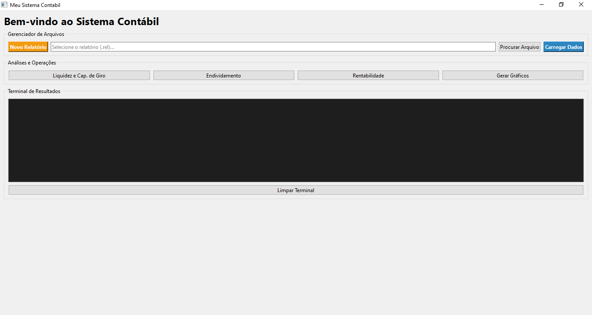
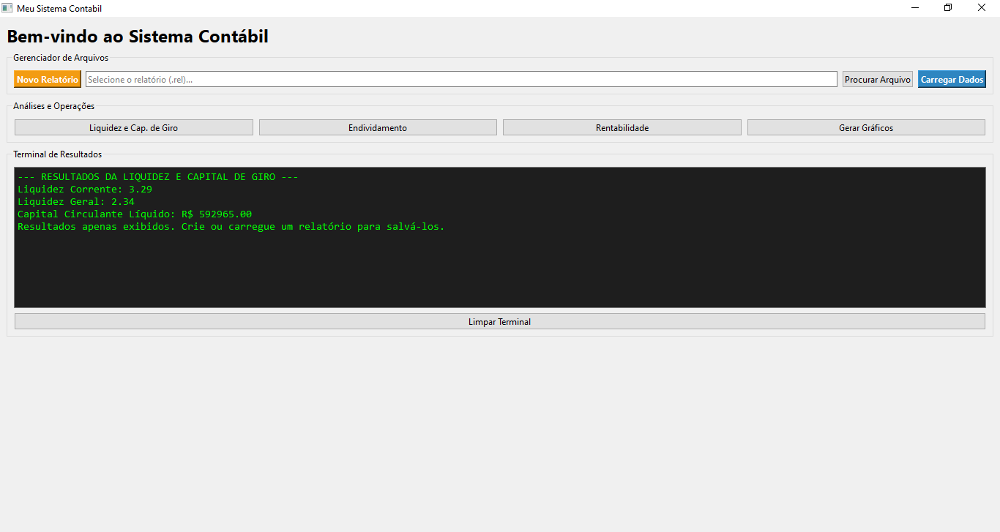
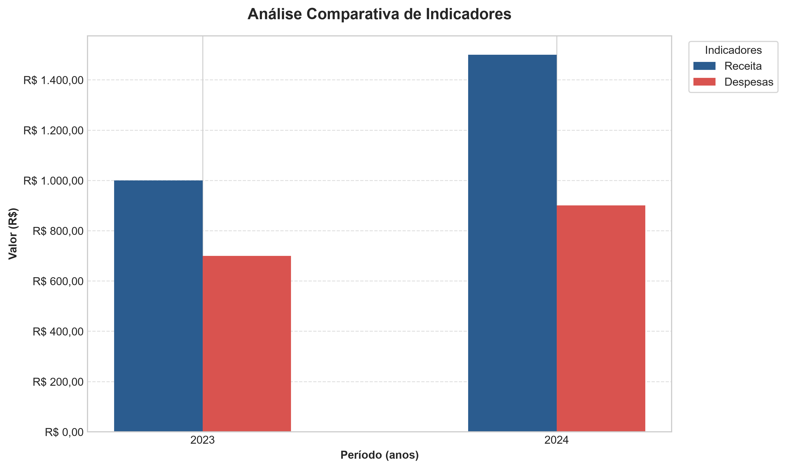

# 📊 Sistema de Análise e Gráficos Contábeis (GUI & CLI)

Este projeto é uma aplicação interativa desenvolvida em Python para facilitar o cálculo de indicadores contábeis essenciais, gerar relatórios de histórico e criar gráficos visuais para análise de desempenho financeiro. 

O sistema conta com uma **Interface Gráfica de Usuário (GUI)** moderna e intuitiva, além de manter a versão clássica de Terminal (CLI) como alternativa.

---

## ✨ Funcionalidades

O sistema é dividido em módulos operacionais integrados:

* **🖥️ Interface Gráfica:** Janelas interativas, seleção de arquivos via explorador do sistema e um terminal visual integrado para acompanhar os resultados em tempo real.
* **🧮 Cálculos de Indicadores:** 
    * **Liquidez e Capital de Giro:** Liquidez Geral, Liquidez Corrente, Capital Circulante Líquido (CCL).
    * **Lucratividade e Rentabilidade:** ROE, EBITDA, Margem EBITDA, ROIC.
    * **Estrutura e Endividamento:** Relação Capital de Terceiros / Capital Próprio, Composição do Endividamento.
* **📝 Gerador de Relatórios:** Salva e carrega o histórico de análises em arquivos (`.rel`).
* **📈 Gerador de Gráficos:** Criação automática de gráficos em `.png` para valores absolutos (barras) ou percentuais (linhas).

---

## 📚 Glossário de Indicadores e Fórmulas

Para garantir total transparência e rigor técnico, o motor de cálculos do sistema utiliza as fórmulas padronizadas da contabilidade financeira. Abaixo estão os indicadores processados pela aplicação:

### 1. Liquidez e Capital de Giro
Mede a capacidade da empresa de honrar seus compromissos financeiros de curto e longo prazo.
* **Liquidez Corrente:** Indica quanto a empresa possui em bens e direitos de curto prazo para cada R$ 1,00 de dívida de curto prazo.
  > `Fórmula: Ativo Circulante / Passivo Circulante`
* **Liquidez Geral:** Visão de longo prazo da liquidez, incluindo direitos e obrigações com prazos maiores.
  > `Fórmula: (Ativo Circulante + Realizável a Longo Prazo) / (Passivo Circulante + Exigível a Longo Prazo)`
* **Capital Circulante Líquido (CCL):** Representa a folga financeira de curto prazo (em R$).
  > `Fórmula: Ativo Circulante - Passivo Circulante`

### 2. Estrutura e Endividamento
Analisa o grau de dependência da empresa em relação a capitais externos e o perfil de suas dívidas.
* **Relação CT/CP (Capital de Terceiros / Capital Próprio):** Indica a proporção de capital externo em relação ao capital dos sócios.
  > **Fórmula:** (Capital de Terceiros / Patrimônio Líquido) * 100

  Onde Capital de Terceiros = Passivo Circulante + Passivo Não Circulante.
* **Composição do Endividamento:** Demonstra qual porcentagem da dívida total vence no curto prazo.
  > `Fórmula: (Passivo Circulante / Passivo Total) * 100`

### 3. Lucratividade e Rentabilidade
Mede a eficiência operacional e o retorno gerado aos acionistas sobre os investimentos realizados.
* **Return on Equity (ROE):** Mede a rentabilidade do dinheiro investido pelos próprios acionistas.
  > `Fórmula: (Lucro Líquido / Patrimônio Líquido) * 100`
* **EBITDA:** Lucro antes de juros, impostos, depreciação e amortização. Reflete a geração de caixa puramente operacional.
  > `Fórmula: Lucro Operacional + Depreciação + Amortização`
* **Margem EBITDA:** Mostra o percentual da receita que se transformou em geração de caixa operacional.
  > `Fórmula: (EBITDA / Receita Líquida) * 100`
* **Return on Invested Capital (ROIC):** Mede a eficiência da empresa em alocar todo o capital à sua disposição (próprio + dívida onerosa).
  > `Fórmula: (NOPAT / Capital Investido) * 100`

---

## 🛠️ Pré-requisitos

Para executar este projeto, você precisará ter o **Python** instalado (versão 3.10 ou superior recomendada). 

> **Aviso para usuários de Windows:** Durante a instalação do Python, certifique-se de marcar a caixa **"Add Python.exe to PATH"** na tela inicial do instalador.

---

## 🚀 Como Instalar e Configurar

Siga o passo a passo abaixo no terminal da sua máquina (Prompt de Comando, PowerShell ou Git Bash):

**1. Extraia os arquivos e acesse a pasta**
Navegue até a pasta do projeto utilizando o terminal.

**2. Crie um Ambiente Virtual (Recomendado)**
Isso isola as bibliotecas do projeto da sua máquina. Digite:
```bash
python -m venv .venv
```

---

### Ative o Ambiente Virtual

* **No Windows (Git Bash):** 
```bash
source .venv/Scripts/activate
```

* **No Windows (CMD):** 
```bash
.venv\Scripts\activate
```

* **No Mac / Linux:** 
```bash
source .venv/bin/activate
```

---

### Instale as Dependências

O sistema utiliza as bibliotecas ```PySide6``` (para a interface gráfica) e ```matplotlib``` (para os gráficos). Instale tudo automaticamente executando:

```bash
pip install -r requirements.txt
```

---

## 💻 Como Usar

Com o ambiente ativado e as dependências instaladas, você tem duas opções para rodar o projeto:

***Opção 1: Abrir com a Interface Gráfica (Recomendado)***

```bash
python main.py
```

Uma janela do aplicativo será aberta. Use os botões para navegar, selecione a pasta para criar/carregar relatórios e preencha os dados nas caixas de diálogo (pop-ups).

***Opção 2: Abrir no modo Terminal (Linha de Comando)***

```bash
python main_cli.py
```

Executa a versão operada puramente por texto direto no seu terminal.

---

## 📸 Demonstração Visual

Abaixo estão algumas capturas de tela demonstrando a nova interface gráfica e os resultados gerados pelo motor do sistema:

**Menu Principal e Gerenciador de Arquivos**
> *Interface principal construída com PySide6, permitindo carregar e criar relatórios facilmente.*


**Análises e Terminal Integrado**
> *Terminal visual integrado que exibe os cálculos contábeis e registra o histórico ativo.*


**Exemplo de Gráfico Gerado**
> *Renderização automática de gráficos comparativos utilizando a biblioteca Matplotlib.*


---

## 📂 Estrutura do Projeto

- **`main.py`**: implementa a interface gráfica (GUI) com PySide6, gerencia as interações do usuário, recebe os dados e apresenta os resultados dos cálculos e gráficos.

- **`main_cli.py`**: disponibiliza uma alternativa de execução pelo terminal (CLI), permitindo realizar as análises contábeis sem utilizar a interface gráfica.

- **`core.py`**: centraliza as importações das bibliotecas, componentes e funções utilizadas pela aplicação, facilitando sua integração entre os diferentes módulos.

- **`src/modules/`**: reúne os módulos responsáveis pelos cálculos dos indicadores contábeis, gerenciamento de relatórios e geração de gráficos.

* **`requirements.txt`**: Lista de dependências externas para execução do código.


---

## ⚠️ Aviso importante e limitações

O **Contabil_Operation** é um projeto desenvolvido com finalidade educacional, demonstrativa e de apoio à análise contábil e financeira.

Os indicadores apresentados são calculados com base nos dados informados pelo usuário e nas fórmulas implementadas no sistema. Portanto, a confiabilidade dos resultados depende da qualidade, consistência e precisão das informações fornecidas.

Os resultados não substituem uma análise contábil profissional, auditoria independente ou orientação de profissionais habilitados. O sistema não realiza validação automática da integridade das demonstrações contábeis utilizadas como entrada.

O projeto encontra-se em desenvolvimento e poderá receber melhorias, correções e novas funcionalidades.

## 📄 Direitos autorais

© 2026 – Todos os direitos reservados ao autor.

Este repositório é disponibilizado publicamente para fins de visualização e demonstração do projeto. A ausência de uma licença explícita não concede autorização para copiar, modificar, distribuir ou utilizar o código em outros projetos.